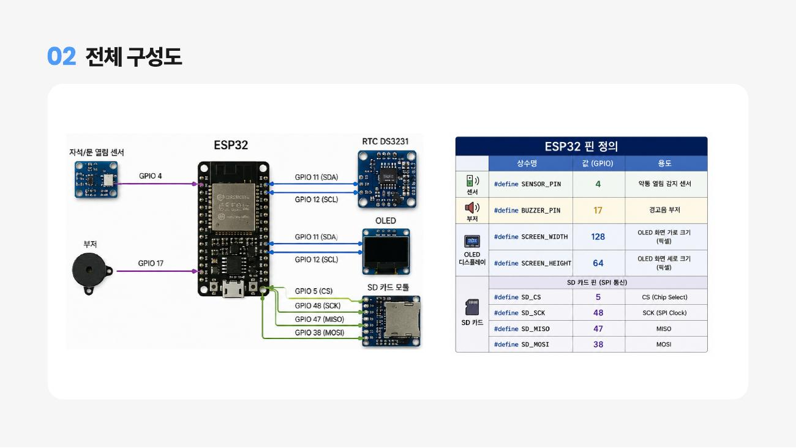
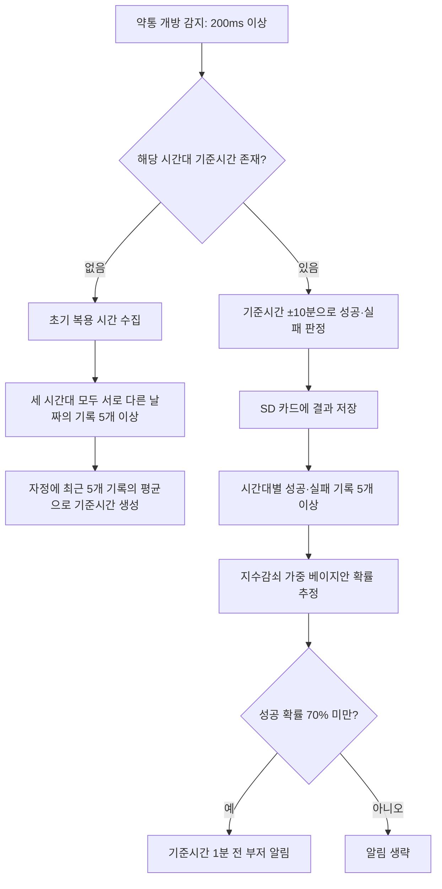

# 스마트 복약 관리 시스템

**약통 개방 기록으로 평소 복용 시간을 학습하고, 복약 성공 확률에 따라 알림을 제공하는 온디바이스 시스템입니다.**

ESP32에서 센서 감지, 복용 기록 저장, 기준시간 계산, 확률 추정, 부저 알림까지 처리합니다. 최근 복약 기록에 더 큰 가중치를 주는 **지수감쇠 가중 베이지안 추정**을 사용하며, 서버 연결 없이 동작합니다.

## 주요 기능

- **약통 개방 감지**: 마그네틱 센서로 약통 상태를 확인하고, 200ms 이상 열린 경우에만 이벤트로 처리합니다.
- **개인별 복용 기준시간 학습**: 아침·점심·저녁 각각 최근 5개 날짜의 복용 시간 평균으로 기준시간을 계산합니다.
- **복약 결과 기록**: 기준시간 ±10분 안에 약통을 열면 `SUCCESS`, 그 밖의 해당 시간대 개방이나 하루 종료 후 미기록은 `FAILURE`로 기록합니다.
- **복약 성공 확률 추정**: 시간대별 성공·실패 기록에 지수감쇠 가중치를 적용해 최근 복약 패턴을 반영합니다.
- **맞춤형 알림**: 추정 성공 확률이 70% 미만인 시간대에는 기준시간 1분 전에 부저를 울립니다.
- **기록 보존 및 상태 표시**: SD 카드에 기록을 저장하고 OLED에 현재 날짜·시간과 약통 상태를 표시합니다.

약통 개방을 복용의 대리 지표로 사용하므로, 기록이 실제 약물 섭취 여부를 직접 확인하는 것은 아닙니다.

## 하드웨어 구성



| 구성 요소 | 역할 | 코드 기준 연결 |
| --- | --- | --- |
| ESP32 계열 보드 | 센서 처리, 기록 분석, 알림 제어 | 아래 GPIO를 지원하는 보드 사용 |
| 마그네틱 개방 센서 | 약통 열림·닫힘 감지 | GPIO 4, `INPUT_PULLUP`, LOW = 닫힘 |
| DS3231 RTC | 현재 날짜·시간 유지 | SDA 11 / SCL 12 |
| SSD1306 OLED | 날짜·시간·약통 상태 표시 | SDA 11 / SCL 12, 주소 `0x3C`, 128 × 64 |
| 부저 | 복약 알림 | GPIO 17 |
| SD 카드 모듈 | 복용 시간·결과·기준시간 저장 | CS 5 / SCK 48 / MISO 47 / MOSI 38 |

구성도는 발표자료에서 가져왔으며, 핀 번호는 저장소의 펌웨어와 대조했습니다. 보드의 정확한 모델은 원본 코드에 명시되어 있지 않으므로, 사용 보드의 핀맵에 맞춰 연결과 상수를 설정해야 합니다.

## 동작 흐름



### 1. 복용 시간 수집과 기준시간 생성

초기 수집 구간은 다음과 같습니다. 같은 날짜·시간대의 학습용 기록은 하나만 저장합니다.

| 구분 | 초기 수집 시간대 |
| --- | --- |
| 아침 `Morning` | 06:00–10:59 |
| 점심 `Noon` | 11:00–15:59 |
| 저녁 `Evening` | 17:00–21:59 |

세 시간대가 모두 최소 기록 수를 충족하면 자정에 기준시간을 생성하거나 갱신합니다. 기준시간 생성 후에는 성공으로 새로 기록된 복용 시간만 학습 기록에 추가합니다.

### 2. 성공·실패 판정

- 약통 개방 시 먼저 기준시간 ±10분 범위에 해당하는지 확인합니다.
- 해당하지 않으면 아침·점심·저녁 수집 구간에 따라 실패 결과를 기록합니다. 수집 구간에도 해당하지 않는 개방은 기록하지 않습니다.
- 하루가 끝나면 결과가 없는 시간대를 실패로 기록합니다. 기준시간 생성일과 그 이전 날짜는 일일 실패 평가에서 제외합니다.
- 이미 성공한 날짜·시간대는 중복 저장하지 않으며, 실패가 먼저 기록되어도 이후 허용 범위 안에서 개방하면 성공으로 갱신합니다.

### 3. 지수감쇠 가중 베이지안 추정

시간대별 결과가 5개 이상이면 각 기록에 다음 가중치를 적용합니다.

```text
wᵢ = exp(-λ × dᵢ)
λ = 0.0495  (반감기 약 14일)

α = 1 + Σ(성공 기록의 가중치)
β = 1 + Σ(실패 기록의 가중치)
P(success) = α / (α + β)
```

`dᵢ`는 기록일로부터 지난 날짜 수입니다. 최근 기록일수록 더 크게 반영되며, Beta(1, 1) 사전분포에 가중 성공·실패 값을 더한 사후평균으로 성공 확률을 추정합니다. 별도의 신경망 모델 파일은 사용하지 않습니다.

### 4. 알림 조건

기준시간이 준비되고 결과 기록이 충분한 시간대 중, 추정 성공 확률이 **70% 미만**이면 알림 대상으로 설정합니다. 해당 시간대에 아직 성공 기록이 없고 약통이 닫혀 있으면 **기준시간 1분 전**에 부저를 울립니다. 부저는 기본값으로 1,000Hz 소리를 300ms씩 3회 출력합니다.

## 실행 방법

### 준비

Arduino IDE에서 Espressif의 ESP32 보드 패키지를 설치하고, 실제 사용하는 보드를 선택합니다. 라이브러리 관리자에서 다음 라이브러리를 설치합니다.

| 라이브러리 | 용도 |
| --- | --- |
| RTClib by Adafruit | DS3231 RTC 제어 |
| Adafruit GFX Library | 화면 출력 |
| Adafruit SSD1306 | OLED 제어 |

`SPI`와 `SD`는 ESP32 보드 패키지에서 제공하는 라이브러리를 사용합니다. 라이브러리 관리자가 안내하는 의존성도 함께 설치합니다.

### 업로드 및 확인

1. [Arduino 스케치](firmware/smart_medication_system/smart_medication_system.ino)를 엽니다. Arduino IDE에 맞춰 폴더와 스케치 이름을 동일하게 구성했습니다.
2. 하드웨어 표와 사용 보드의 핀맵을 확인해 연결합니다.
3. 아래 RTC 테스트 설정을 확인합니다.
4. 보드와 포트를 선택하고 컴파일·업로드합니다.
5. 시리얼 모니터를 **115200 baud**로 열어 RTC·SD 카드 초기화와 기록 메시지를 확인합니다.
6. 약통을 열고 닫아 OLED 상태와 SD 카드 기록을 확인합니다.

### RTC 테스트 설정

원본 펌웨어의 `setup()`에는 아래 테스트 코드가 **활성화되어 있습니다**.

```cpp
rtcModule.setFakeTime(2026, 9, 9, 23, 59, 50);
```

따라서 그대로 실행하면 부팅할 때마다 위 날짜·시간으로 되돌아갑니다. 실제 사용 시 현재 날짜·시간으로 한 번 설정한 뒤, 이 호출을 주석 처리하고 다시 업로드해 RTC 시간을 유지하세요. 저장소의 펌웨어는 원본 동작을 보존했습니다.

## 기본 설정

펌웨어 상단의 상수로 동작 기준을 조정할 수 있습니다.

| 상수 | 기본값 | 의미 |
| --- | --- | --- |
| `MIN_BASELINE_RECORDS` | `5` | 시간대별 기준시간 계산에 필요한 날짜별 기록 수 |
| `MIN_RESULT_RECORDS` | `5` | 시간대별 성공 확률 계산에 필요한 결과 수 |
| `SUCCESS_RANGE_MINUTES` | `10` | 기준시간 전후 성공 인정 범위(분) |
| `ALERT_BEFORE_MINUTES` | `1` | 기준시간보다 먼저 알릴 시간(분) |
| `ALERT_THRESHOLD` | `0.70` | 알림 대상 판정 확률 |
| `DECAY_LAMBDA` | `0.0495` | 과거 기록의 가중치 감쇠 계수 |
| `SENSOR_STABLE_MS` | `200` | 유효한 개방으로 처리할 최소 지속시간(ms) |

## 저장소 구조

```text
smart_medication_system/
├── README.md
├── .gitignore
├── .gitattributes
├── firmware/
│   └── smart_medication_system/
│       └── smart_medication_system.ino
└── docs/
    ├── project-presentation.pdf
    ├── sd-card-format.md
    └── images/
        └── system-overview.jpg
```

- [발표자료: AI 기반 약물 복용 도우미](docs/project-presentation.pdf)
- [SD 카드 파일 형식과 일일 처리 일정](docs/sd-card-format.md)

제공된 최종 `.ino` 파일은 파일명과 위치만 정리했으며 내용은 변경하지 않았습니다. 보드 모델·라이브러리 버전·정량적 성능 측정치는 별도로 제공되지 않았습니다. 저장소 정리 과정에서 하드웨어 컴파일 및 실기기 동작 시험은 수행하지 않았습니다.
